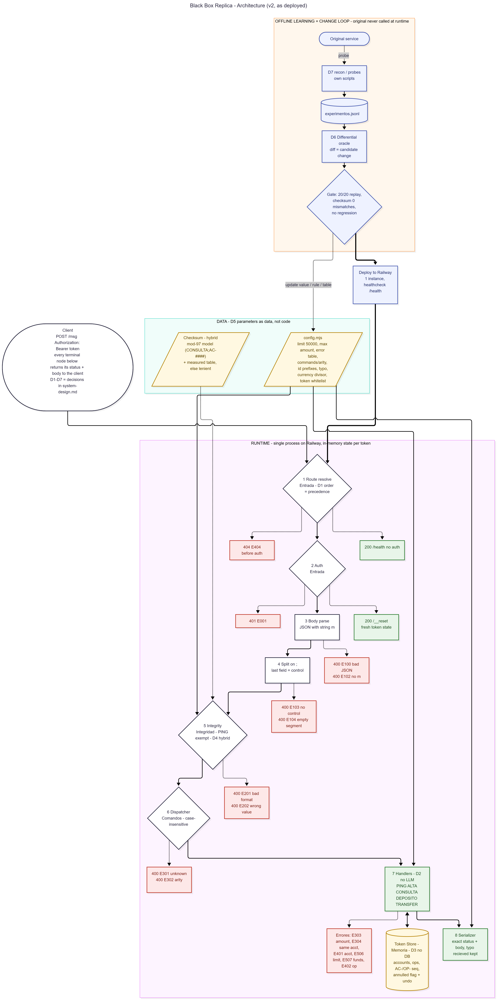

---

# The Black Box — Lab10 Frontier Hackathon

> "Are you the top 1% of technical talent in the region?"

That question is why I applied to the **Lab10 Frontier** hackathon. I joined to prove my skills — not with a test, but by building something hard in a day.

**The challenge: The Black Box.** An HTTP service running in production for 10 years. No source. No docs. The people who wrote it are gone. And if it goes down, the company goes down.

We couldn't open it. We could only ask it.

**How I solved it:**

1. **Recon** — treated it as an oracle. Thousands of requests, every answer recorded.
2. **Inference** — for each input→output pair I formed a hypothesis of the rule, isolated one variable, measured, adjusted, verified against everything known, then encoded it.
3. **Rebuild** — my own service, answering byte for byte the same: same errors, same typos.

**The turning point:** the last field was a checksum. I assumed modulo 100 and it was off by 3. That `+3` was the clue — 100 minus 97 is 3. The real modulus was **97**. Result: **71/100 hidden tests**, up from 42 to 63 to 71.

The scoring worked like the evals top AI labs (Anthropic, OpenAI) run for their recruiting process: a hidden test set, exact-match scoring, one measured pass rate.

**The biggest lessons:**

- Analyze and design the system first.
- The pitch and the debrief force real technical depth. If you can't explain it, you don't understand it.

**What I didn't expect:** the people — founders and companies scouting the region's best technical talent.

Would you apply to a challenge like this?

---

## Watch the 2-minute pitch

<video src="docs-hackathon/demo/hackathon-20261010-frontier-pitch.mp4" controls preload="metadata" width="100%"></video>

▶️ [Download / open the pitch video](docs-hackathon/demo/hackathon-20261010-frontier-pitch.mp4)

## Technical demo

<video src="docs-hackathon/demo/technical-demo.mp4" controls preload="metadata" width="100%"></video>

▶️ [Download / open the technical demo](docs-hackathon/demo/technical-demo.mp4)

> **Note:** these MP4s are large (~113 MB and ~248 MB). GitHub's inline player only renders videos uploaded through the github.com web editor (drag-and-drop produces a `user-attachments` URL); plain repo files may not autoplay there, and files over 100 MB need Git LFS to push. Swap each `src` for the drag-drop URL if you want them to play inline on GitHub.

---

# Black Box Replica — the code

A **byte-identical replacement** for an undocumented HTTP service: same status codes and same response bodies, including its errors and its typos. State is kept **in memory, per token**. The replica **never calls the original service**.

Think of it this way: the original is a sealed black box — you can't see inside, so you learn it purely by feeding it inputs and watching the outputs. This repo is the reconstruction of those observed rules.

## How it works

Every request flows through one straight pipeline. Each stage is one section of the behavior spec, and the **stage order is the error precedence** (which error wins when several could apply):

```
request
  → 1. Route resolve      (unknown route → 404, before auth)
  → 2. Auth               (bad/missing token → 401)
  → 3. Body parse         (bad JSON → E100, no "m" → E102)
  → 4. Split on ";"       (last field = control)
  → 5. Integrity          (control checksum; PING is exempt)
  → 6. Dispatch           (command name, case-insensitive)
  → 7. Handlers + Store   (PING, ALTA, CONSULTA, DEPOSITO, TRANSFER, ANULA; per-token memory)
  → 8. Serializer         (exact status + body, typo "recieved" preserved)
  → response
```

All tunable values (transfer limit, id prefixes, max amount, error table, command arity, currency divisor) live in **`src/config.mjs`** as data, so a behavior change is a data edit, not a code rewrite.

## Architecture diagram



- Diagram source (Mermaid): [`docs/design/architecture.mmd`](docs/design/architecture.mmd)

## Design & specification docs

| Document | What's inside |
|---|---|
| [`docs/design/system-design.md`](docs/design/system-design.md) | Problem, assumptions, scope, decisions (D1–D7) with the alternative each one rejected, and the measurement plan. |
| [`docs/spec.md`](docs/spec.md) | Full behavior spec — every rule with an ID, evidence, and a confidence level (confirmed / probable / assumed). |
| [`docs/design/architecture.mmd`](docs/design/architecture.mmd) | Source for the architecture diagram above. |
| [`experimentos.jsonl`](experimentos.jsonl) | Experiment log — one line per request sent to the original service. |

## Project structure

| Path | What it is |
|---|---|
| `src/server.mjs` | HTTP server (Node stdlib, zero dependencies). Implements the pipeline: route → auth → parse → integrity → dispatch → handlers → store → serializer. |
| `src/config.mjs` | All adjustable parameters (prefixes, limits, error contract, typos, checksum mode). |
| `src/checksum.mjs`, `src/known-controls.mjs` | The control-checksum model (mod-97) plus the measured lookup table. |
| `tools/recon.mjs` | Recon harness: `replay`, `probe`, `crack`. |
| `tools/control-dataset.json`, `tools/weights.json`, `tools/char-values.json` | Measured data behind the checksum model. |
| `experimentos.jsonl` | Experiment log (one line per request to the original). |
| `docs/spec.md` | Service specification. |
| `docs/design/` | System design doc + architecture diagram. |
| `docs-hackathon/` | Hackathon material: challenge brief, rubric, planning, demo (pitch + video). |

## Run it locally

Requires **Node.js ≥ 18**. No install step — there are no dependencies.

```bash
npm start                 # starts on http://localhost:8080 (uses $PORT if set)
```

In another terminal:

```bash
curl http://localhost:8080/health        # -> 200
```

Everything below is optional.

## Verify it

Replays the 20 captured examples against the replacement, entirely offline:

```bash
npm test
```

Expected: **20/20** pass. This runs the server logic in-process — no network, no original service.

## API contract

- `GET /health` → `200` (readiness probe).
- `POST /__reset` → resets that token to its initial state.
- `POST /msg` → `{"m":"CMD;arg;...;control"}` — the main command entrypoint (any route the original had).
- Every call carries `Authorization: Bearer <token>`; state is isolated per token.

## Deploy (Railway)

`Procfile` and `railway.json` are included; the `startCommand` is `node src/server.mjs`. Railway injects `PORT` automatically.

```bash
# Option A: connect the repo in railway.app (recommended)
# Option B: CLI
npm i -g @railway/cli
railway login
railway init
railway up
```

The container is stateless — all state lives in memory and is cleared by `POST /__reset`. Run a **single instance** (state is per-process).

## Recon tools (advanced)

These talk to the **original** service and are only needed to re-derive behavior. They require a `.env` with `CAJA_NEGRA_URL` and `CAJA_NEGRA_TOKEN` (never committed).

```bash
node tools/recon.mjs replay              # replay the 20 examples
node tools/recon.mjs probe "PING;64"
node tools/recon.mjs crack "ALTA;Lucia"  # control sweep 0..99
```

Rate limit respected by the harness: 10 req/s, 8000/day.

## Environment variables

| Variable | Used by | Purpose |
|---|---|---|
| `PORT` | server | Listen port (default `8080`; injected by the host). |
| `ENTRYPOINT_TOKEN` / `CAJA_NEGRA_TOKEN` | server auth | Allowed bearer token(s) for the deployed entrypoint (comma-separated). If unset, any non-empty bearer is accepted. |
| `CONTROL_MODE` | server | `strict` (default, validates the checksum) or `lenient` (debug only). |
| `CAJA_NEGRA_URL` | recon tools | Base URL of the original service. |
| `CAJA_NEGRA_TOKEN` | recon tools | Personal token for the original service. |

Secrets live in `.env`, which is git-ignored — never commit them.
